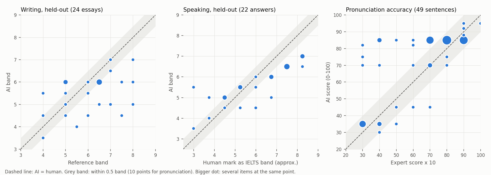

# W9 evidence: calibration with a human-scored subset

The AI grader (Gemini `gemini-3.5-flash-lite`, prompts `writing-v1.2` and `speaking-v1.2`, unchanged) is compared with human scores on
public sets. Every answer goes through the real system, the same path a learner uses: HTTP submit, then the backend, then Whisper and
pronunciation scoring for Speaking, then the Gemini grader.
A calibration is fitted on a small **calibration** split and checked, unchanged, on a **held-out** split. The prompts were not tuned on
either split.

Files:
- [metrics.csv](metrics.csv): all metrics.
- [errors.csv](errors.csv): every error of 1 band or more.
- [calibration.json](calibration.json): the fitted maps.
- [results/](results/): one row per answer, with scores and error codes only.
- [figures/agreement.png](figures/agreement.png): agreement plot.
- [pron_speechocean.csv](pron_speechocean.csv): pronunciation sample.
- [manifest.json](manifest.json): sha256, commit and settings.

`speaking_sample.csv` and `eval_exercises.sql` contain the S&I question texts, so they are git-ignored. `run.sh` makes them again from
the corpus with a fixed seed.

## Data and design

| Set | Human score | Calibration | Held-out | Licence / storage |
|---|---|---|---|---|
| Writing: `data/writing_v1`, Task 2 | Reference band (overall + TR, CC, LR, GRA) from writing9.com | `dev`, 16 essays | `test`, 24 essays | As in `data/writing_v1` |
| Speaking: Speak & Improve Corpus 2025, dev, Part 3 | Holistic mark 0–6 of trained human assessors (3 = B1, 4 = B2, 5 = C1) | 8 answers | 22 answers | Registration with Cambridge, no redistribution. Audio and transcripts are not in Git. |
| Pronunciation: speechocean762, test, adults | Expert accuracy, fluency and prosody (0–10, multiplied by 10) | – | 49 sentences | CC BY 4.0. Audio is not in Git. |

- **Speaking sample.** The 30 answers are stratified by human mark from 2.0 to 5.5 (seed 9, [select_speaking.py](select_speaking.py)),
  and the first answer of each level goes to calibration. Part 3 is a 60 s opinion answer, so it is graded as `QT_S_PART3`.
- **Scale mapping (approximate).** Cambridge places IELTS 4.0–5.0 at B1, 5.5–6.5 at B2 and 7.0–8.0 at C1, so
  mark = (band − 4.5) / 1.5 + 3. Errors are reported in IELTS bands.
- **What the Speaking marks can show.** S&I gives one holistic mark per part, with no FC/LR/GRA/P breakdown. The four Speaking criteria
  can therefore only be compared by rank (Spearman). Pronunciation is checked separately against experts on speechocean762.
- **Metrics:**
  - MAE.
  - Bias (AI − human).
  - Share within ±0.5 and ±1.0 band. For the Writing criteria, the ±0.5 column means exact agreement, because the reference
    criterion bands are whole numbers.
  - QWK, computed on half-band classes.
  - Spearman correlation.
- **Calibrations:** "offset" (mean error) and "linear" (least squares). Both are fitted on the calibration split, rounded to 0.5, and
  applied to the held-out split unchanged.

## Results (held-out)

| Set | n | Calibration | MAE | Bias | ±0.5 | ±1.0 | QWK | Spearman |
|---|---|---|---|---|---|---|---|---|
| Writing overall | 24 | none | 1.04 | −0.67 | 50% | 63% | 0.36 | 0.44 |
| | | offset (+0.22, rounds to 0) | 1.04 | −0.67 | 50% | 63% | 0.36 | 0.44 |
| | | linear (0.77·AI + 1.58) | 0.96 | −0.38 | 42% | 75% | 0.32 | 0.36 |
| Speaking overall vs P3 mark | 22 | none | 0.88 | −0.33 | 41% | 68% | 0.70 | 0.83 |
| | | offset (+0.44) | 0.83 | +0.17 | 41% | 82% | 0.70 | 0.83 |
| | | linear (1.58·AI − 2.57) | **0.67** | +0.26 | 50% | 82% | **0.81** | 0.83 |

Writing criteria, held-out, no calibration:

| Criterion | MAE | Bias | Exact | ±1.0 | QWK |
|---|---|---|---|---|---|
| TR | 1.08 | −0.50 | 38% | 79% | 0.22 |
| CC | 0.96 | −0.63 | 46% | 75% | 0.32 |
| LR | 1.21 | −0.63 | 13% | 67% | 0.34 |
| GRA | 1.38 | −0.96 | 21% | 58% | 0.22 |

Speaking criteria against the P3 mark, held-out, rank only:
- FC: Spearman 0.82.
- LR: 0.81.
- GRA: 0.77.
- P: 0.79.
- Pronunciation scores: accuracy 0.54, fluency 0.72, prosody 0.68 (n = 21; one answer has no pronunciation score).

Pronunciation against speechocean762 experts (n = 49, on a 0–100 scale):

| Score | Spearman | MAE | Bias |
|---|---|---|---|
| Accuracy | 0.73 | 14.7 | +5.2 |
| Fluency | 0.73 | 12.9 | −0.5 |
| Prosody | 0.69 | 13.2 | −1.3 |

## Error analysis

[errors.csv](errors.csv) lists 18 of 40 essays and 15 of 30 Speaking answers that are 1 band or more off.

1. **Range compression is the main error.** The AI pulls bands towards 5.5–6. Mean AI − human by human band:

   | Human band | Writing | Speaking |
   |---|---|---|
   | ≤ 5 | +0.62 | +0.88 |
   | 5.5–6.5 | −0.57 | −0.81 |
   | ≥ 7 | −1.42 | −1.50 |

   13 essays have a reference band of 7 or more, but only 3 get 7 or more from the AI.
2. **Under-scored high bands**: 9 essays and 8 Speaking answers.
   - In Writing, the largest criterion gap is spread over TR, CC, LR and GRA. GRA has the largest negative bias (−0.96): the grader
     counts every error as evidence and does not credit range.
   - In Speaking, the largest gap is FC in 9 of 15 cases. A 60 s answer is short for the IELTS descriptors of "speaks at length".
3. **Over-scored low bands**: 5 essays and 4 Speaking answers.
   - In Speaking, the largest gap is P in 3 of 4 cases.
   - The same pattern appears on speechocean762: sentences that experts score 30–60 often get 70–85 from Gemini.
     Gemini's pronunciation scores are too generous for weak speakers.
4. **Calibration.**
   - **Writing:** no help. The offset is too small to move a band. The linear map has a slope below 1 (0.77), so it compresses the
     range even more: MAE goes down but QWK and Spearman go down too.
   - **Speaking:** the linear map widens the range (slope 1.58) and improves held-out MAE from 0.88 to 0.67 and QWK from 0.70 to 0.81.
     However, it is fitted on only 8 answers.
5. **Comparison with W3.** The W3 baseline on the same `test` essays had MAE 1.13, 46% within ±0.5 and r = 0.43. W9 finds MAE 1.04,
   50% and Spearman 0.44: no real change since W3, so the Writing grader is stable but compressed.

**Decision.** No calibration is switched on in the code this week.
- Writing needs a prompt change, not a post-hoc map: band anchors for 4 and 7–8, and GRA that credits range as well as errors.
- The Speaking linear map is a candidate to be confirmed on a larger calibration set.
- This held-out set has now been looked at. Any prompt change must be checked on new essays, not on the W9 `test` split.

## Limits

- **Writing reference bands** are community scores from writing9.com, not certified examiner scores.
- **Speaking human marks** are holistic CEFR-aligned marks for one part only. The CEFR-to-IELTS map is approximate: one CEFR level
  covers about 1.5 bands, and marks fall on quarter bands.
- **Sample sizes are small**: 24 and 22 held-out answers, and 8 Speaking calibration answers. A difference of about 0.2 band in MAE is
  within noise.
- **The speechocean762 sample** is stratified by score, which inflates correlation. The speakers are Mandarin L1 adults reading
  sentences aloud, not spontaneous speech.
- **LLM noise.** Grading uses real LLM calls, so bands can move by about 0.5 between runs.
- **Retries.** Gemini returned 503 (overload) for about half of the calls. Failed items were retried in later passes, with at most
  15 requests per minute. Every item was graded in the end, so no item was dropped.

## Reproduce

Run `bash Evidence/W09/run.sh`. It needs:
- An empty Postgres database.
- The ASR service with `PRON_ENABLED=true`.
- The backend.
- `GEMINI_API_KEY` in the environment.
- ffmpeg.
- The S&I and speechocean762 corpora downloaded outside the repo.

See the header of [run.sh](run.sh). Neo4j is not needed for grading.
